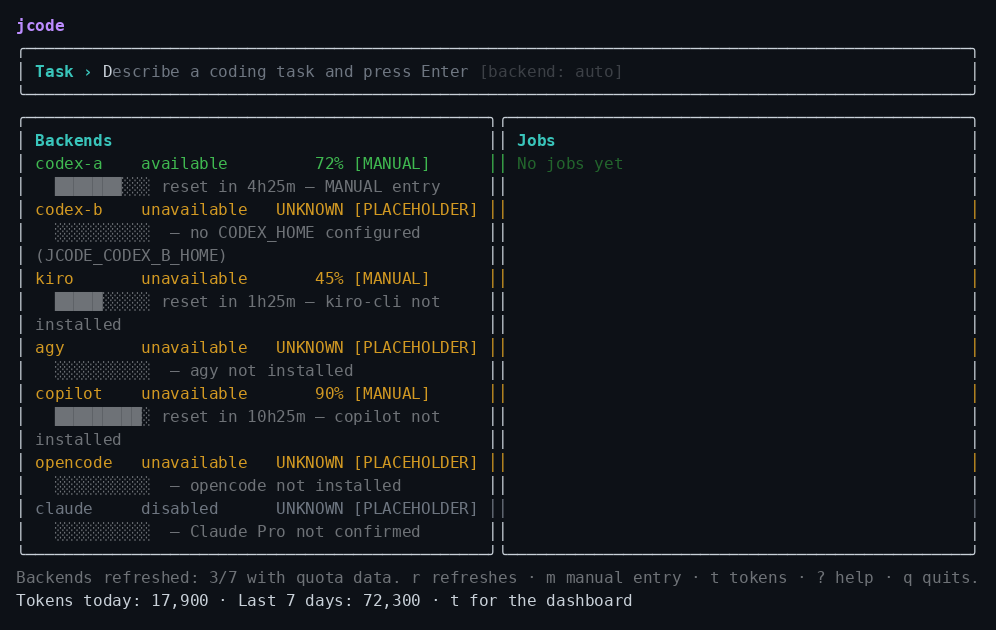

# scode

[](https://www.npmjs.com/package/scode)
[](https://github.com/sivab193/scode/actions/workflows/ci.yml)
[](LICENSE)

`scode` is the npm package and repository; it installs the `jcode` command.

`jcode` is a local-first, quota-aware router for coding-agent CLIs. One command
chooses an eligible backend for a whole job, launches the vendor's unmodified
binary, streams its output, and records the routing decision in a local ledger.

The first host is macOS. Runtime state lives in `~/.jcode` (or `JCODE_HOME`)
and is never committed.

## Status

- ✅ Base scaffold + real Codex dispatch (Codex, Nov 18, 2026)
- ✅ Phase 0 — `jcode doctor` smoke-test harness (run it on the host to go green)
- ✅ Phase 1 — router core: real kiro/agy/copilot/opencode adapters, quota
  probes, rule-based classifier, quota-floor + soonest-expiring policy,
  worktree-per-job dispatch with one fallback, JSONL ledger
- ✅ Phase 2 — full TUI: manual quota entry (`m`), backend override (↑↓),
  jobs pane with live elapsed / tokens / output tail, help overlay (`?`)
- ✅ Phase 3 — Caveman efficiency layer (opt-in per backend, telemetry off,
  Auto off; every run records `cavemanWrapped` in the ledger for measurement)
- ✅ Phase 4 — MCP tool suite v1: `jcode-tools` server (file-peek, pdf-read,
  latex-build, graph-query) + `jcode tools install` wiring into Codex/Claude/
  Kiro/Copilot/OpenCode configs; doctor load-tests the server for real
- ✅ Phase 5 — learning loop: `jcode learn` folds the ledger into
  `~/.jcode/learn-report.md` (per-backend×class stats, Caveman on/off,
  retries, prompt patterns, tool backlog, dead tools, proposed tweaks)
- ✅ Phase 6 — measured policy refinement: expected-cost scoring with
  Beta-smoothed success priors (20-run floor per pair, reset time priced
  in), rules-based effort selection, and the Laya classification seam
  (`JCODE_LAYA_URL`; rules take over when Laya is not serving)

Beyond the phases: the lessons store (`jcode learn` appends each fold to
`~/.jcode/lessons.md`), the real claude adapter (implemented, still disabled
behind the double-gate until Pro is live), the repo-root prompt pack
(`prompts/` — brief template, per-backend steering, shared `JCODE_NOTES.md`,
seeded into each job's worktree), CI on Node 20/22, and host docs
(`docs/host-setup.md`, `docs/codex-local-testing.md`).

Claude stays disabled until Claude Pro is confirmed live (~Nov 30, 2026) and
its smoke test passes. Never enable it on your own.

## Quick start

Requires Node.js 20+ and at least one authenticated backend CLI.

```sh
npx -y scode doctor --quick   # try it without installing
npm install -g scode          # install the `jcode` command
jcode                          # open the terminal UI
```

From source instead:

```sh
npm install
npm run build
npm link
```

Publishing notes (name, first publish, releases) live in
[docs/publishing.md](docs/publishing.md). `jcode` is taken on npm, so the
package is `scode`; the binary is still `jcode`.

## Links

- [npm package](https://www.npmjs.com/package/scode)
- [source code](https://github.com/sivab193/scode)
- [issues and feature requests](https://github.com/sivab193/scode/issues)
- [releases](https://github.com/sivab193/scode/releases)

## Terminal UI

Bare `jcode` opens the TUI: a task bar on top, backends with live quota bars
on the left, running jobs on the right. `m` enters quota by hand when a probe
is missing, `↑↓` pins a backend, `?` shows the keys.



More shots: [help overlay](docs/shots/tui-help.png),
[manual quota entry](docs/shots/tui-manual.png),
[typed task with backend override](docs/shots/tui-override.png),
[token usage dashboard](docs/shots/tui-tokens.png).

## Usage

```sh
jcode                         # open the Ink terminal UI
jcode run "review this change"
jcode run --backend codex-a "add tests"
jcode run --dry-run "show me the exact command, run nothing"
jcode status                  # per-backend headroom (runs quota probes)
jcode doctor                  # Phase 0 smoke tests for this machine
jcode doctor --quick          # presence + probes only, no live dispatches
jcode doctor --full           # also test the Caveman wrap on codex
jcode learn                   # learning fold (Phase 5) -> ~/.jcode/learn-report.md
jcode tokens                  # token usage dashboard (today + last 7 days)
jcode graph init [path]       # build the repo code graph (Graphify, local only)
jcode tools install           # wire the jcode-tools MCP server into backends
jcode tools status            # show MCP wiring per backend
jcode schedule add "review open PRs" --cron "0 9 * * 1-5"   # recurring job
jcode schedule add "ping me" --in 2h                        # one-shot job
jcode schedule list           # scheduled jobs and their next runs
jcode schedule tick           # fire everything due right now
```

`jcode run` defaults to the current directory and runs each job in its own git
worktree (kept on failure for inspection, removed on success). It never
extracts or reuses a vendor login token: adapters only spawn official CLIs.

Scheduled jobs fire through the same router at the time you set — either
while the TUI is open (it ticks every minute) or via the OS scheduler
(`jcode schedule install` prints the cron/schtasks wiring). Full guide:
[docs/scheduling.md](docs/scheduling.md).

Token usage comes from the ledger: the TUI's bottom bar always shows
today's tokens and the last 7 days, `t` opens the full dashboard
(per-backend bars, daily bars, Caveman on-vs-off), and `jcode tokens`
prints the same dashboard headless. Runs that reported no usage data are
counted separately — totals are what backends reported, never padded.

Code graph (Graphify): `jcode graph init` once per repo builds a local,
queryable map of the code (functions, classes, calls, imports) — no LLM
calls, nothing leaves the machine. Dispatch builds it when it is missing or
stale, and agents query it through the `graph-query` MCP tool instead of
grepping for structure. Full guide: [docs/graphify.md](docs/graphify.md).
Dart/Flutter is not parsed yet, so Flutter repos get no graph coverage.

## Backends

`codex-a`, `codex-b`, `kiro`, `agy`, `copilot`, `opencode`, `claude`.
Missing CLIs and unavailable quota probes are reported honestly as
unknown/unavailable; placeholder data is labeled, never faked as live.

- **codex-a / codex-b** — separate `CODEX_HOME` per account
  (`JCODE_CODEX_A_HOME`, `JCODE_CODEX_B_HOME`). Quota via the app-server
  JSON-RPC probe (consumes no quota).
- **kiro** — `KIRO_API_KEY` from the environment. Quota via `/usage`.
- **agy** — Google's Antigravity CLI (binary `agy`), not Auggie, not Aider.
  Quota probing is best-effort; reactive mode (per-run usage + 429s) is the
  design, not a bug.
- **copilot** — CLI >= v1.0.28. Bills in premium requests; exit code 3 means
  the limit is reached (hard stop, no retry). Tracked in the ledger.
- **opencode** — v2 only, free models by default (`opencodeModel` in
  `~/.jcode/config.json`). No native quota; if it points at a subscription
  pool it draws on the same pool as that adapter.
- **claude** — adapter implemented (`claude -p … --permission-mode
  acceptEdits --max-turns N`, `--resume`, `--max-budget-usd`) but disabled
  until Pro is live (config `claudeEnabled` AND `JCODE_CLAUDE_ENABLED=true`).
  Quota probe reads a status-line `rate_limits` file when one exists
  (`JCODE_CLAUDE_RATE_LIMITS_FILE`).

## Policy

Rule-based routing, refined by measured priors (Phase 6): AWS work → kiro,
huge-repo exploration → agy, GitHub work → copilot, free-model work →
opencode, deep reasoning → claude (once live). Among eligible backends the
soonest-expiring quota goes first, accounts below the floor (default 10%
remaining) are skipped unless they are the only option, and cooling-down
accounts are never picked. On a classified failure the dispatcher falls back
once: quota failures cool the account down and route sideways, capability
failures escalate to a stronger backend.

When a (backend, class) pair has 20+ runs in the ledger, expected-cost
scoring ranks the pick: `(1 − P(success)) × fallback penalty + expected
tokens × quota scarcity × reset factor`. The reset factor is the point — a
backend resetting in 6 hours is nearly free to spend now, one resetting in
6 days is not. Below 20 runs the rule order applies unchanged, and scoring
never auto-applies policy changes; the durable edits stay proposals in the
learn report.

Classification is rules-first with a Laya seam: when Laya is serving
(`JCODE_LAYA_URL`, `POST /classify`), jcode asks it first and falls back to
the rules when it is not configured or its answer is invalid.

## Prompt pack

Every job runs in a git worktree seeded with the prompt pack from `prompts/`:
`AGENTS.md` (codex/agy), `CLAUDE.md` (claude), `.kiro/steering/jcode.md`
(kiro), and the shared `JCODE_NOTES.md` lessons file. Files the repo already
has are never overwritten. The brief is wrapped in the template
(`prompts/brief-template.md`) — the user's words verbatim under `## Task`,
working rules below — while the ledger keeps the raw brief.

## Docs

- [Host setup](docs/host-setup.md) — installing the CLIs, two Codex homes,
  config, and the weekly `jcode learn` habit.
- [Codex local testing](docs/codex-local-testing.md) — what can only be
  verified on the host machine, in order.
- [iTerm2](docs/iterm2.md) — why it helps on the Mac (tmux `-CC` is the
  `jcode attach` story), and why nothing in the router depends on it.

## Development

```sh
npm run build    # TypeScript build
npm test         # build + node:test suite (125 tests)
npm run check    # typecheck only
```

No paid API credits are required or used. OpenCode defaults to free models.
